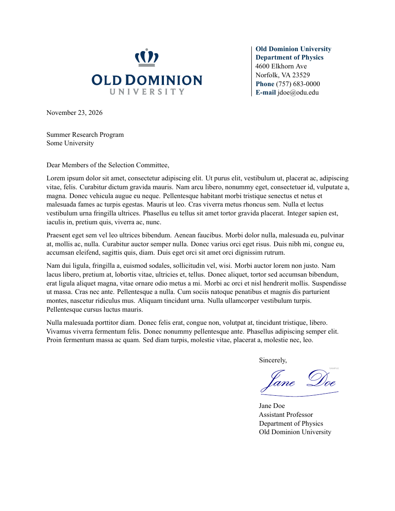

# oduletter

A [Quarto](https://quarto.org) format for Old Dominion University letters, built for writing recommendation letters. It produces a one-click PDF with the ODU letterhead, your return address and contact details, a recipient block, page numbers on continuation pages, and a signature block.



## Installing

To start a new letter from the template:

```bash
quarto use template mgrau/oduletter
```

This installs the extension into `_extensions/` and creates an example `.qmd` file to start from.

To add the format to an existing project or folder:

```bash
quarto add mgrau/oduletter
```

Quarto looks for `_extensions/` in the document's folder and in its parent folders, so a single install at the top of a `recommendation letters/` folder covers every letter beneath it.

## Writing a letter

```yaml
---
author:
    name: Jane Doe
    degrees: Assistant Professor
    email: jdoe@odu.edu
    phone: (757) 683-0000
    affiliation:
      - name: Old Dominion University
        department: Department of Physics
        address: 4600 Elkhorn Ave
        city: Norfolk
        state: VA
        postal-code: 23529
address:
    - Summer Research Program
    - Some University
opening: Dear Members of the Selection Committee,
closing: Sincerely,
format: oduletter-pdf
---

Lorem ipsum dolor sit amet, ...
```

Render it with:

```bash
quarto render letter.qmd
```

### Options

| Option | Purpose |
|---|---|
| `author` | Your name, title (`degrees`), email, phone, and `affiliation` (name, department, street address, city, state, postal code). These fill the return-address block, the footer, and the signature. |
| `address` | Recipient block, one list item per line. |
| `opening` | Salutation, e.g. `Dear Admissions Committee,` |
| `closing` | Sign-off, e.g. `Sincerely,` |
| `signed` | `true` (the default) places the signature image; `false` leaves blank space so you can sign by hand. |
| `signature-image` | Path to your signature image (PDF or PNG), relative to the letter. Defaults to the bundled placeholder. |
| `date` | Letter date. Defaults to today. |
| `subject` | Optional subject line under the recipient block. Change the label with `subject-title` (default `Subject`). |
| `cc`, `encl`, `ps` | Carbon copies, enclosures, and a postscript after the closing. |
| `fontsize`, `mainfont`, `geometry` | Standard Quarto PDF options; override the defaults below. |

### Defaults

11 pt Times New Roman (Arial for sans serif), 1 inch margins, US letter paper, rendered with XeLaTeX. Times New Roman and Arial ship with macOS and Windows. On Linux, install them or set `mainfont`/`sansfont` to fonts you have.

## Your signature

The extension bundles a **placeholder** signature ("Jane Doe", marked SAMPLE) so the template renders out of the box. To use your own:

1. Scan or draw your signature and save it as a PDF or PNG with a transparent or white background, e.g. `my-signature.pdf`.
2. Put it next to your letter (or in a parent folder and use a relative path).
3. Add `signature-image: my-signature.pdf` to the letter's YAML.

Don't overwrite `_extensions/oduletter/signature.pdf`: `quarto update` would replace it, and if you commit your `_extensions/` folder, your signature would end up in version control.

## Requirements

Quarto 1.4 or later and a TeX distribution with XeLaTeX (`quarto install tinytex` works).
